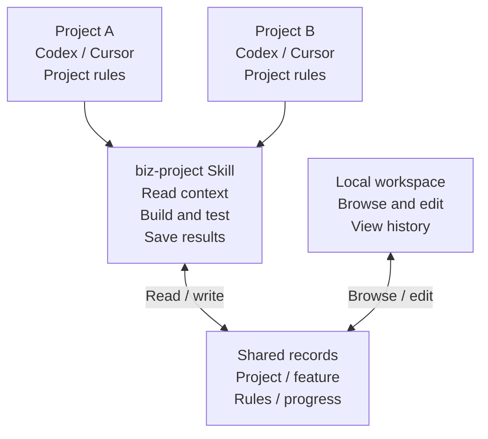

<div align="center">


# Biz Project

**English** · [简体中文](README.zh-CN.md)

### Many projects. Different AI tools. Shared progress.

A local project workspace, an agent skill, and a development rules library.<br />Each project keeps its own rules. Codex and Cursor follow the same workflow for recording progress.

[](https://github.com/wnagchi/biz-project/releases) [](https://github.com/wnagchi/biz-project/actions/workflows/ci.yml) [](https://nodejs.org/) [](LICENSE)

[Why Biz Project](#why-biz-project) · [Preview](#local-project-workspace) · [How it works](#how-the-skill-and-project-rules-work-together) · [Quick start](#quick-start) · [Changelog (中文)](CHANGELOG.md)

</div>

## Why Biz Project

Biz Project grew out of a recurring problem: **when you work on several projects across different AI coding tools, progress and project rules get scattered across conversations.**

A change you just finished in Codex needs explaining again in Cursor. Several agents report that their parts are done, while the feature's overall progress remains unclear. As projects multiply, their testing, branching, release, and collaboration rules also diverge. Copying prompts between them makes those rules hard to maintain.

Biz Project saves this context in a local records center you choose: **agreements belong to projects, progress follows features, and development rules can be reused.** You review the whole picture in the workspace. Agents read the context before working and write back their results, giving the next tool a starting point it can check against the code.

<!-- Preserve the platform anchor referenced by existing Skill instructions. -->
<a id="本地项目管理平台"></a>

## Local project workspace

Keep a project's starting point, design decisions, and latest verification results in records you can maintain and revisit on the next task.

<a href="docs/assets/workbench.png"></a>

<p align="center"><sub>Actual workspace · Project → Feature → Record · Screenshots show the Chinese interface with fictional demo data</sub></p>

## How the skill and project rules work together

**Project rules tell the agent when to use the skill. The skill explains the recording workflow. The records center keeps the project's actual progress.**



| Part | What it does |
| --- | --- |
| **Project rules** | Codex loads the invocation instructions from `AGENTS.md` or an existing `AGENTS.override.md`. Cursor uses `.cursor/rules/biz-project.mdc` by default. The entry identifies the project and tells the agent to read its records before working. |
| **Agent skill** | The agent reads `SKILL.md`, follows its workflow, and uses the bundled Node.js helper to locate projects, reuse feature records, and save individual updates, verification evidence, and handoff notes. |
| **Records center** | Stores agreements, decisions, results, and next steps by project and feature. A new tool or conversation reads the same records. |
| **Development rules library** | Packages reusable agreements into modules and schemes. Customize them for each project's stack, verification commands, branches, and release requirements, then preview and apply them to the target tool's rule files. |

Each task follows the same cycle:

1. **Read before working.** Load the project rules, invoke the skill, and read the project's agreements and existing feature record.
2. **Continue the same feature.** Check the code and pending work, record key decisions, make changes, and run the required verification.
3. **Write back the outcome.** Save changes, verification results, unresolved issues, and next steps. Parallel contributors submit separate updates for the owner to review and consolidate.
4. **Pick up next time.** Switching projects loads that project's agreements. Switching tools within a project keeps the same project and feature IDs.

Progress stays in sync through **agents following the workflow and reading and writing shared records**. The skill is a set of instructions and scripts executed by the current agent. Files such as `AGENTS.md` do not run background jobs or transfer conversations. Independent machines or clones do not automatically synchronize their records or code.

→ [Read the full explanation: from project rules to agent handoffs](docs/how-it-works.md)

## Three connected workflows

### 01 · See the next step across projects

Switch projects in the overview, group features by status or time, and read their current records. Scope, decisions, verification results, and pending work stay together, making it easier to review both active work and blockers.

- **Track progress:** project and feature filters, status/time groups, and full-text search across projects.
- **Maintain records:** project agreements, feature documents, individual updates, and edit history, with Markdown reading and source/preview editing.
- **Review history:** the shared service captures record snapshots while running; browse earlier content, pause watching, and rescan.

### 02 · Continue a feature from Codex to Cursor

For example, implement a login API in Codex, then continue the UI integration in Cursor. The earlier record keeps interface decisions, verification results, and pending work. The next agent reads that same feature and checks it against the current code, reducing the background you need to repeat.

```text
Use biz-project to continue this project's login feature.
Read the project agreements and existing feature record, check the current code,
and continue the remaining integration work.
Write the actual changes, verification results, and next steps back to that feature.
```

When agents work in parallel, each contributor submits a separate update. The feature owner checks the code and evidence before updating the master record. Completing one assignment does not automatically mark the entire feature as integrated or released.

<details>
<summary><strong>View individual progress updates</strong></summary>
<br />


Updates from different authors are saved separately and consolidated after review. Author labels identify the source of a record; they are not team accounts or an agent scheduler.

</details>

### 03 · Reuse development rules across projects

Maintain modules and complete schemes in a separate rules library, covering lifecycle, development, verification, releases, and agent collaboration. Rules use Markdown and can expose project parameters. Compose them for a project, then preview the result before applying it.

For example, frontend and backend projects can share requirements to verify changes before a commit and include evidence in handoffs, while keeping different test commands, branches, and release criteria. Templates support reuse; project rule files and profiles hold the agreements adopted by each project.

- **Reuse agreements:** edit, copy, archive, and restore modules and schemes.
- **Review before applying:** select the project and tool, confirm parameters, and preview the write scope before approval.
- **Preserve existing rules:** export a merge task for the current agent to review, then import and approve the proposed draft.

The rules library also works independently of centralized records. Applied project rules remain separate files; changing a template does not automatically overwrite them.

<details>
<summary><strong>View the rule module editor</strong></summary>
<br />


</details>

## Quick start

Requires **Node.js 20+**. Prebuilt web assets are included, so **you do not need to run `npm install` first**.

### 1. Get the source

[Download and extract the ZIP](https://github.com/wnagchi/biz-project/archive/refs/heads/main.zip), or clone the repository:

```sh
git clone https://github.com/wnagchi/biz-project.git
cd biz-project
```

### 2. Set up once, reuse later

On Windows, double-click **`install.cmd`**. From a terminal, run this in the repository directory:

```sh
npm run setup
```

In the browser, **choose an external records center → select projects and Codex / Cursor → review the preview → approve installation**. Existing records and project rules are preserved; older documents are not automatically migrated. The installed skill links to this source directory, so keep it in place after setup.

### 3. Open the workspace and start developing

In the wizard, click **「打开项目管理」 (Open project management)**, or double-click **`start.cmd`** on Windows. For later use, start the workspace directly. Terminal users can open another terminal in the repository directory and run:

```sh
npm start
```

Use `$biz-project` in Codex or `/biz-project` in Cursor. The workspace lets you browse and maintain records; the skill guides agents through reading, recording, and handing off work.

> **Network access:** `npm start` / `start.cmd` accepts private IPv4 LAN connections by default. Devices on the same subnet can view and edit records without an access code. For local-only access, run `npm start -- --no-lan`; check local settings when reusing an existing service. The setup wizard and agent-triggered startup listen on loopback only. See [Security (中文)](SECURITY.md).

## Your data stays where you choose

Project records use **Markdown + JSON**, with the records center, rules library, and source code stored separately. Read and back up the files directly, or edit them in the workspace. Browser saves check for conflicts, and the shared service maintains document snapshots while running.

Source releases exclude your project records, local configuration, and service credentials. The repository includes ignore rules and a check for files being prepared for commit. See the [privacy guide (中文)](docs/privacy.md).

<details>
<summary><strong>Scope and limitations</strong></summary>

- Currently targets local Codex / Cursor workflows. Other tools require an explicitly selected rule file; this does not imply a verified native adapter. Entry generation and shared data workflows have been tested, which does not replace independent behavior checks in each agent product's UI.
- There is no cloud sync, team account system, model API integration, or automatic agent scheduling. Private LAN access shares the local records; it does not synchronize agents on different machines.
- Feature status describes actual progress. Setting it to released does not execute Git operations, deploy code, or verify a release.
- Snapshots support browsing history. Automatic restore, diffing, and cleanup are not currently provided. Updating source files does not replace a running service; save drafts before an explicit service restart.
- Template imports, project enrollment, and important writes have their own preview and confirmation steps. Collaboration records do not authorize spawning agents or merging code.

</details>

## Explore further

English and Chinese are available for this README and the workflow guide. Other linked documents retain their existing languages, marked below where relevant.

| Topic | Start here |
| --- | --- |
| Skills, project rules, and progress across tools | [How it works](docs/how-it-works.md) · [Skill instructions](SKILL.md) |
| Installation, workspace, and CLI | [User guide (中文)](docs/usage.md) · [Walkthrough (中文)](docs/walkthrough.md) |
| Enrollment and record structure | [Initialization](references/initialization.md) · [Record format](references/record-format.md) |
| Reusable rules and handoffs | [Rule templates](references/rule-templates.md) · [Collaboration and synchronization](references/collaboration.md) |
| External apps and service lifecycle | [Local app integration](references/service-control.md) |
| Contributing and releases | [Contributing (中文)](CONTRIBUTING.md) · [Version policy (中文)](docs/versioning.md) · [Changelog (中文)](CHANGELOG.md) |

Share use cases and reproducible issues through [GitHub Issues](https://github.com/wnagchi/biz-project/issues), or contribute a focused improvement. The contribution guide covers frontend setup, verification commands, and screenshot requirements.

---

<div align="center">

**Local files · Readable records · Context you can continue**

[MIT License](LICENSE) · [Lucide license](web/LUCIDE-LICENSE.txt) · [Marked notices](web/vendor/README.md)

</div>
