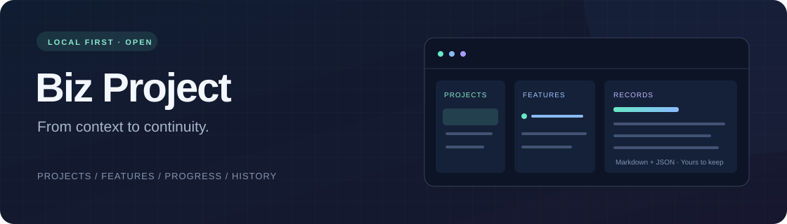

<div align="center">



<h1>Biz Project</h1>

<p><strong>让项目上下文延续，让每次开发都有据可查。</strong></p>
<p>面向本地 Agent 工作流的集中项目记录与管理平台。<br />把项目约定、功能进度、验证结果和交接记录，保存在你自己的 Markdown 与 JSON 中。</p>

[](LICENSE)
[](CHANGELOG.md)
[](https://nodejs.org/)
[](https://github.com/wnagchi/biz-project/actions/workflows/ci.yml)
[](docs/privacy.md)

[快速开始](#快速开始) · [功能一览](#功能一览) · [使用文档](#使用文档) · [参与贡献](CONTRIBUTING.md) · [问题反馈](https://github.com/wnagchi/biz-project/issues)

</div>

## 为什么需要它

换一个聊天、切一个工具，项目背景往往要重新解释。Biz Project 将这些需要延续的信息从聊天里整理出来：为什么这样做、现在做到哪里、验证过什么、还有什么没有完成。

同一项目在本地 Codex 和 Cursor 间共用稳定的项目与功能 ID。Agent 按 Skill 维护记录，你在浏览器中查看和编辑；记录中心独立于源码，使用普通文件保存，便于备份和长期维护。

> **适合**：同时维护多个本地项目、跨聊天继续开发、在不同 Agent 工具之间交接。<br />
> **当前边界**：不提供云同步、团队账号、Agent 自动调度或自动部署。多工具接入不代表已完成各产品 UI 的独立行为验证。

## 快速开始

### 1. 获取项目

安装 **Node.js 20+** 与 **Git**，然后克隆到准备长期保留的位置：

```sh
git clone https://github.com/wnagchi/biz-project.git
cd biz-project
```

运行平台和安装向导无需 `npm install`，仓库已包含编译后的界面。前端开发建议使用 Node.js 24，见 [贡献指南](CONTRIBUTING.md)。

### 2. 完成接入

Windows 双击 **`install.cmd`**，或在终端运行：

```sh
npm run setup
```

在本机浏览器中，按 **选择记录中心 → 选择项目与工具 → 审阅修改 → 确认安装** 完成接入。记录中心由你明确选择，必须在源码和业务项目之外；浏览或预览不会自动安装，也不会迁移旧记录。

安装器为 Codex 与本地 Cursor 建立共享 Skill 入口，链接到此工程目录。**安装后请保留工程目录的位置。** 终端备用入口为 `install-terminal.cmd` / `npm run setup:terminal`。

### 3. 开始使用

Windows 双击 **`start.cmd`**，或运行：

```sh
npm start
```

在 Codex 中通过 `$biz-project` 调用，在 Cursor 中通过 `/biz-project` 选择 Skill。可以这样开始：

```text
用 biz-project 管理这个项目，先读取项目约定与已有功能记录，再继续本次开发。
```

**网络访问**：`npm start` / `start.cmd` 主动启动平台默认接受私人 IPv4 局域网，同网段设备可直接查看和编辑记录，无访问码。需要仅本机访问时用 `npm start -- --no-lan`；服务复用时请核对本机设置中的实际 LAN 状态。安装向导和 Agent 联动启动仅监听本机。HTTP 不加密，只用于可信私人网络，详见 [安全说明](SECURITY.md)。

## 功能一览

| 能力 | 可以做什么 |
| --- | --- |
| 集中项目记录 | 统一保存项目约定、功能范围、关键决策、验证与交接，避免每个聊天各记一份 |
| 本地管理工作台 | 项目、功能、记录三栏联动；搜索、状态/时间分组、折叠与窄屏逐级浏览 |
| Markdown 阅读与编辑 | 源码/预览切换、冲突检查与草稿保护；保存原始 Markdown |
| 文档快照 | 共享服务监听记录变化，保留原始字节与时间；支持查看历史和暂停监听 |
| 多工具接入 | Codex / Cursor 共用记录，分别维护调用入口；其他工具可显式选择规则文件 |
| 开发规则模板 | 独立规则库管理模块与方案，先预览再写入；保留已有规则时交给当前 Agent 审阅 |
| 外部应用联动 | 本机连接发现、认证握手、服务状态与明确启停；保持中心授权和停止语义 |

### 本地项目管理平台

平台直接读取与 Skill 相同的 JSON / Markdown，不创建第二套数据库。支持查看项目约定、新建与编辑功能、追加独立进展、浏览修改历史和跨项目搜索。状态修改属于记录编辑；“已上线”不会触发部署或自动生成发布证据。

记录 HTML 按文字处理，图片不会自动加载，链接协议受限；浏览器资源本地提供。界面与保存、恢复、服务生命周期的详细边界见 [完整使用手册](docs/usage.md#本地项目管理平台)。

## 数据属于你

```text
biz-project/                  这个源码仓库：Skill、脚本、模板、界面、测试

<records-root>/               你选择的外部记录中心
├── registry.json
└── projects/
    └── <project-id>/
        ├── project.json
        ├── README.md         项目约定
        └── features/
            └── <feature-id>/
                ├── feature.json
                ├── README.md 功能主记录
                └── updates/  独立进展
```

本机配置、服务身份和私人记录不属于开源内容。仓库提供忽略规则与 `npm run check:privacy`；提交前还应检查暂存内容，运行 `npm run check:privacy -- --staged`。检查器覆盖常见文件和密钥模式，不能代替人工脱敏或扫描完整 Git 历史，详见 [隐私发布指南](docs/privacy.md)。

已保存的“不参与记录”选择会在同一配置下继续生效；Windows 的短路径和长路径别名也会匹配，初始化 Git 不会清除这个选择。

## 使用文档

| 文档 | 内容 |
| --- | --- |
| [完整使用手册](docs/usage.md) | 平台、安装、CLI、多工具、快照与兼容行为 |
| [运行示例](docs/walkthrough.md) | 从首次接入到开发、交接与发布记录的文字模拟 |
| [初始化规范](references/initialization.md) | 记录中心确认、项目参与、安装器与共享服务 |
| [记录格式](references/record-format.md) | 项目、功能、独立进展和快照的数据契约 |
| [协作与同步](references/collaboration.md) | 汇总负责人、进展幂等、同步与发布证据 |
| [规则模板](references/rule-templates.md) | 模块、方案、审阅和批准后的导入 |
| [应用联动契约](references/service-control.md) | 本机发现、服务控制与外部应用接入 |
| [工程设计](docs/design.md) | 数据边界、初始化原则与兼容设计 |
| [版本与发布规范](docs/versioning.md) | 版本来源、更新日志、标签与发布校验 |

## 开发与贡献

欢迎提交可复现的问题或聚焦的改进。开始前请阅读 [贡献指南](CONTRIBUTING.md) 和 [工程约定](AGENTS.md)，近期变化见 [更新记录](CHANGELOG.md)。

```sh
npm test                 # Node 测试，写入仅使用临时目录
npm run check            # 脚本语法检查
npm run version:check    # 版本、更新记录与版本说明一致性
npm run check:privacy    # Git 工作区候选文件检查
```

修改前端时先运行 `npm ci`，再执行 `npm run build:web`。CI 配置覆盖 Linux / Windows、Node.js 20 / 22 / 24 的脚本检查与测试，以及前端构建和已跟踪内容的隐私检查；浏览器验收环境另见贡献指南。

## 开源协议

本项目采用 [MIT License](LICENSE)，允许使用、修改与商业分发，请保留许可和版权声明。第三方资源保留各自许可：[Lucide](web/LUCIDE-LICENSE.txt)、[Marked](web/vendor/README.md)；构建产物中的第三方声明也应保留。

<div align="center">

<sub>Built for local workflows. Kept in files. Made to continue.</sub>

</div>
