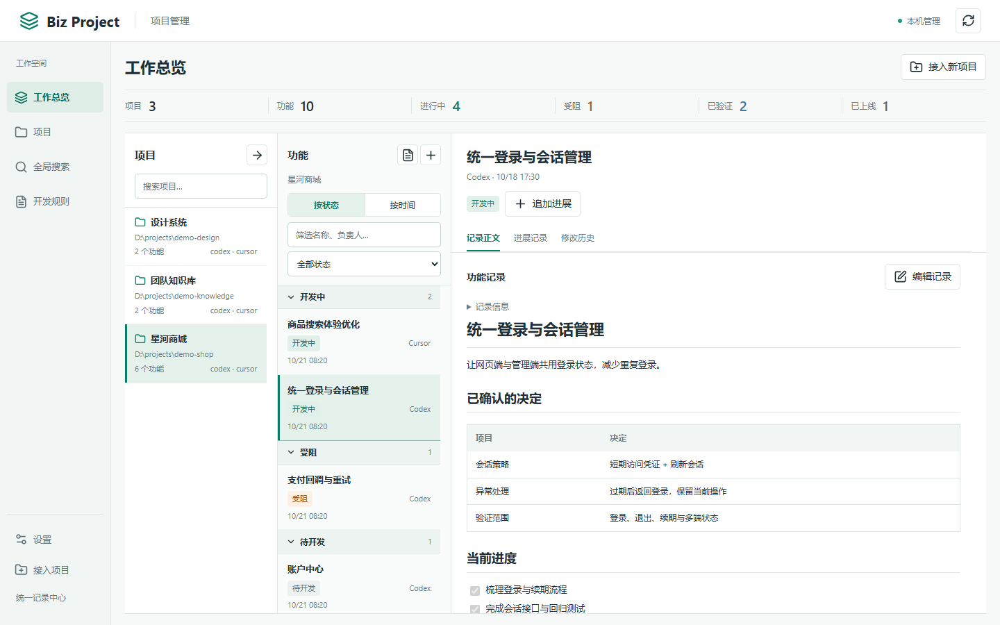
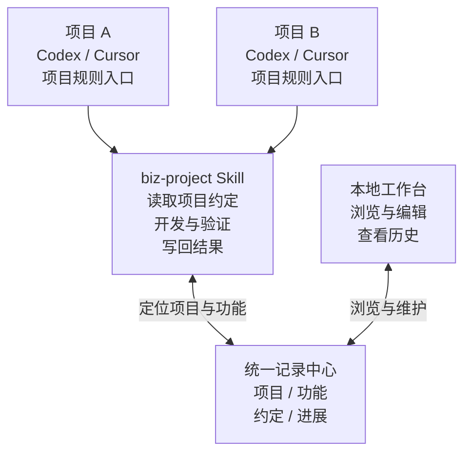
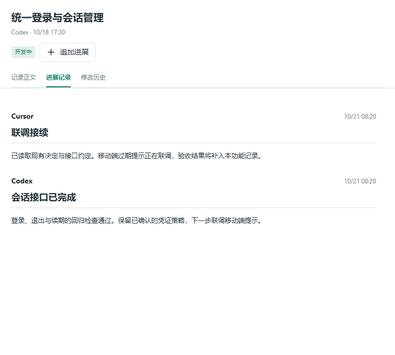
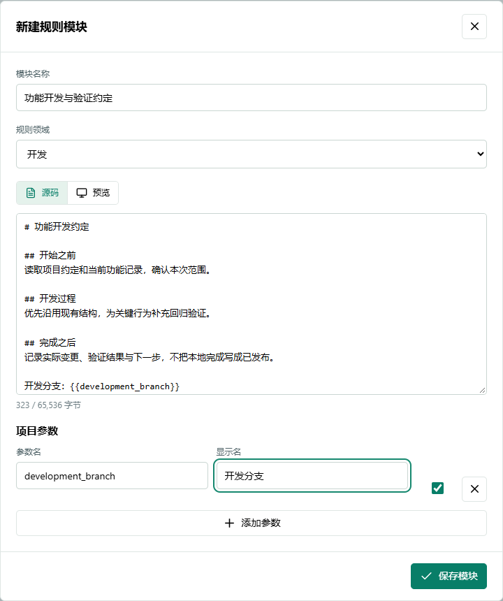

<div align="center">


# Biz Project

[English](README.md) · **简体中文**

### 多个项目，多种 Agent 工具，接着同一份进度继续开发。

本地项目工作台 + Agent Skill + 开发规则库。<br />各项目保留自己的约定，Codex / Cursor 按同一套记录流程接续工作。

[](https://github.com/wnagchi/biz-project/releases) [](https://github.com/wnagchi/biz-project/actions/workflows/ci.yml) [](https://nodejs.org/) [](LICENSE)

[为什么做](#为什么会有-biz-project) · [界面预览](#本地项目管理平台) · [工作原理](#skill-如何与项目规则配合) · [快速开始](#快速开始) · [更新记录](CHANGELOG.md)

</div>

## 为什么会有 Biz Project

这个项目起源于一个反复遇到的开发痛点：**同时推进多个项目，又在多个 Agent 工具之间切换时，进度和规则很容易散落在不同对话里。**

刚在 Codex 中完成的修改，换到 Cursor 后需要重新交代；几个 Agent 同时处理一个功能时，各自说“完成了”，却难以判断整体还差什么。项目越来越多，测试、分支、发布和协作约定也各有不同，靠复制提示词维护容易遗漏或过时。

Biz Project 把这些信息落到一个你指定的本地记录中心：**项目约定按项目保存，进展按功能接续，开发规则按需复用。** 你在工作台看全局，Agent 在开发前读取上下文、完成后写回结果，下一个工具便有可核对的起点。

## 本地项目管理平台

一个项目从哪里开始、某个功能为什么这样做、上次验证到了哪一步——把这些信息留在可继续维护的记录里，下次开发便有了起点。

<a href="docs/assets/workbench.png"></a>

<p align="center"><sub>真实工作台 · 项目 → 功能 → 记录三栏联动 · 截图中的项目与内容均为演示数据</sub></p>

## Skill 如何与项目规则配合

**项目规则告诉 Agent“何时调用”，Skill 告诉 Agent“怎样记录”，记录中心保存“这个项目实际进行到了哪里”。**



| 组成 | 具体做什么 |
| --- | --- |
| **项目规则入口** | Codex 通过 `AGENTS.md` 或已有的 `AGENTS.override.md` 加载调用约定；Cursor 默认使用 `.cursor/rules/biz-project.mdc`。入口关联项目 ID，提醒 Agent 开工前读取记录。 |
| **Agent Skill** | Agent 读取 `SKILL.md`，按流程调用随附的 Node.js helper，定位项目、复用功能记录、保存独立进展，并维护验证和交接信息。 |
| **统一记录中心** | 按项目与功能分开保存约定、决策、结果和下一步。换工具或新建对话时，继续读取同一份记录。 |
| **开发规则库** | 将通用约定做成模块和方案，按各项目的技术栈、验证命令、分支和发布要求定制，预览后应用到对应工具的规则文件。 |

一次开发形成一个闭环：

1. **开工先读**：Agent 加载项目规则，调用 Skill，读取该项目约定与已有功能记录。
2. **围绕同一功能推进**：核对代码与待办，记录关键决定，完成修改和实际验证。
3. **结束写回**：保存修改、验证结果、未解决事项和下一步；并行参与者各写独立进展，由负责人核对汇总。
4. **下次接着做**：换项目读取另一套约定；换工具继续同一项目时，沿用原项目 ID 和功能 ID。

这里的“同步”依靠 **Agent 按约定读写共享记录**。Skill 是由当前 Agent 阅读并执行的指令与脚本集合；`AGENTS.md` 等入口本身不会启动后台任务，也不会传输聊天。独立机器或独立克隆的记录与代码不会自动同步。

→ [深入了解：从规则入口到多 Agent 交接的完整过程](docs/how-it-works.zh-CN.md)

## 把开发里的三件事接起来

### 01 · 多个项目，也能看清下一步

在工作总览中切换项目，按状态或时间整理功能，直接阅读当前记录。需求范围、关键决定、验证结果和待办有各自的位置，受阻项与正在推进的工作可以一起查看。

- **看进度**：项目与功能筛选、状态/时间分组、跨项目全文搜索。
- **维护记录**：项目约定、功能正文、独立进展和修改历史，支持 Markdown 阅读与源码/预览编辑。
- **找历史**：共享服务保存记录文档快照，可浏览过往内容、暂停监听和重新核对。

### 02 · 从 Codex 到 Cursor，也能沿着同一个功能继续

例如，你先在 Codex 中实现登录接口，随后让 Cursor 继续页面联调。前一次记录保留接口决定、验证结果和未完成项；后一个 Agent 读取同一功能，再对照当前代码接续，减少重新交代背景。

```text
用 biz-project 继续这个项目的登录功能。
先读取项目约定和已有功能记录，核对当前代码，再处理尚未完成的联调。
本次完成后，把实际修改、验证结果和下一步写回同一个功能记录。
```

多个 Agent 并行时，每个参与者提交独立进展，避免同时改写同一份总结。功能负责人核对代码和验证证据后更新主记录；某个参与者完成一部分，不会自动把整个功能标记为已集成或已上线。

<details>
<summary><strong>查看独立进展示例</strong></summary>
<br />


不同作者的进展分别保存，由负责人核对后汇总。作者标签用于记录来源，不是团队账号或自动调度功能。

</details>

### 03 · 把开发约定，变成下一项目可复用的规则

在独立的开发规则库中维护模块和完整方案，覆盖生命周期、开发、验证、发布与 Agent 协作。规则正文使用 Markdown，可设置项目参数，按项目组合后再预览应用。

例如，前端项目与后端项目可以复用“提交前验证”和“交接需附证据”的约定，同时保留各自的测试命令、分支与上线条件。规则模板负责复用，项目规则文件与项目档案负责落实本项目的具体约定。

- **复用约定**：编辑、复制、归档和恢复模块/方案。
- **先看差异**：选择目标项目和工具，确认参数与写入范围后再批准。
- **保留已有规则**：导出合并任务交给当前 Agent 审阅，导入草案后再次核对和确认。

规则库可以独立使用，目标项目无需先加入集中记录。已经应用到项目的规则独立保存，修改模板不会自动覆盖项目。

<details>
<summary><strong>查看规则模块编辑界面</strong></summary>
<br />


</details>

## 快速开始

运行需要 **Node.js 20+**，已包含预编译网页资源，**无需先运行 `npm install`**。

### 1. 获取源码

[下载 ZIP](https://github.com/wnagchi/biz-project/archive/refs/heads/main.zip) 并解压，或使用 Git：

```sh
git clone https://github.com/wnagchi/biz-project.git
cd biz-project
```

### 2. 一次接入，后续复用

Windows 双击 **`install.cmd`**；其他终端在工程目录运行：

```sh
npm run setup
```

在浏览器中按 **选择外部记录中心 → 选择项目与 Codex / Cursor → 审阅预览 → 确认安装** 完成接入。已有记录和项目规则会保留，旧文档不会自动迁移。Skill 入口链接到此源码目录，接入后请保留该目录的位置。

### 3. 打开工作台，开始开发

向导中点击 **「打开项目管理」**，或 Windows 双击 **`start.cmd`**。之后可直接启动平台；终端用户在另一个终端进入工程目录运行：

```sh
npm start
```

在 Codex 中使用 `$biz-project`，在 Cursor 中选择 `/biz-project`。平台负责浏览和维护记录，Skill 为 Agent 提供读取、记录与交接的工作约定。

> **访问范围**：`npm start` / `start.cmd` 默认接受私人 IPv4 局域网，同网段设备可直接查看和编辑记录，无访问码。仅需本机访问时运行 `npm start -- --no-lan`；复用已有服务时请核对本机设置。安装向导与 Agent 联动启动仅监听本机。详见 [安全说明](SECURITY.md)。

## 数据留在你选择的位置

项目记录以 **Markdown + JSON** 保存，记录中心、规则库和源码分开存放。你可以直接查看与备份原文件，也可以从网页编辑；修改冲突会被检查，文档快照由共享服务在运行时维护。

源码发布不包含你的项目记录、本机配置或服务凭据。仓库提供忽略规则和提交候选检查，详见 [隐私指南](docs/privacy.md)。

<details>
<summary><strong>使用前需要了解的边界</strong></summary>

- 当前面向本地 Codex / Cursor 工作流；其他工具需显式选择规则文件，不代表已经提供原生适配。入口生成与共用数据流程已验证，不能代替各 Agent 产品 UI 的独立行为验证。
- 本项目不提供云同步、团队账号、模型 API 接入或 Agent 自动调度。私人局域网访问共用本机记录，不等于跨机器 Agent 同步。
- 功能状态记录实际进展。选择“已上线”不会执行 Git、部署或自动核验发布。
- 快照可浏览历史，当前不提供自动恢复、差异比较或自动清理。源码更新也不会替换已运行的后台服务，服务升级需先保存草稿再明确重启。
- 模板导入、项目接入和重要写入有各自的预览/确认流程。支持协作记录，不等于授权创建子 Agent 或自行合并代码。

</details>

## 继续探索

| 想了解什么 | 从这里开始 |
| --- | --- |
| Skill、项目规则与多工具进度如何衔接 | [工作原理与协作示例](docs/how-it-works.zh-CN.md) · [Skill 指令](SKILL.md) |
| 安装、平台操作与 CLI 用法 | [完整使用手册](docs/usage.md) · [运行示例](docs/walkthrough.md) |
| 接入与记录格式 | [初始化规范](references/initialization.md) · [记录契约](references/record-format.md) |
| 规则复用与交接 | [开发规则模板](references/rule-templates.md) · [协作与同步](references/collaboration.md) |
| 外部应用与服务 | [本机应用联动](references/service-control.md) |
| 参与开发与版本维护 | [贡献指南](CONTRIBUTING.md) · [版本规范](docs/versioning.md) · [更新记录](CHANGELOG.md) |

欢迎通过 [Issue](https://github.com/wnagchi/biz-project/issues) 交流使用场景与可复现的问题，也欢迎提交聚焦的改进。前端开发环境、验证命令与截图要求见贡献指南。

## 友情链接

[LinuxDO（L站）](https://linux.do/)

---

<div align="center">

**本地运行 · 文件可读 · 上下文可接续**

[MIT License](LICENSE) · [Lucide 许可](web/LUCIDE-LICENSE.txt) · [Marked 说明](web/vendor/README.md)

</div>
